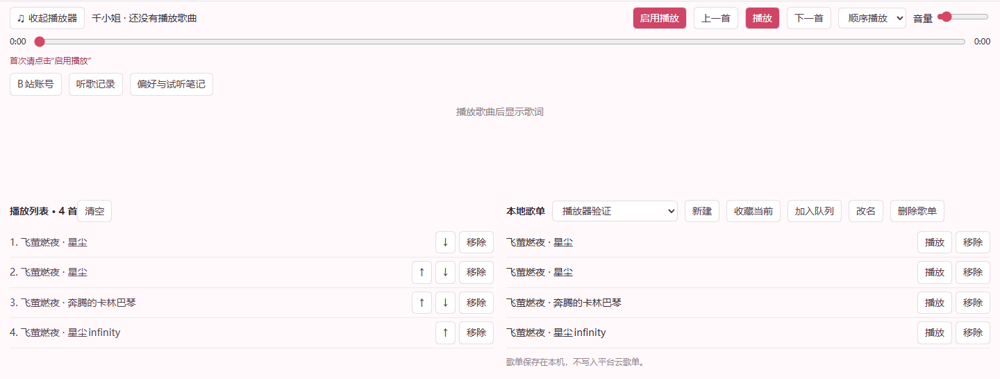

# 千小姐 · Qian Music for DSH

让 Qwen Omni 原生听歌，再按你的要求找歌、试听、建歌单。轻量播放器直接在 DSH 窗口底部运行，无需旧音乐室，也不另开浏览器。

**v0.3 加入 B站原生视频工具链**：用户扫码登录，搜索和浏览视频，下载合并实际音视频，交给当前 Omni 主会话直接听看；可读取评论、通知，并在用户授权下发表评论、回复或动态。不会用字幕、抽帧摘要或另一个模型代替观看。



## 下载与配置入口

- [项目源码](https://github.com/littlexie1/qian-music-dsh) · [安装包与版本说明](https://github.com/littlexie1/qian-music-dsh/releases)
- [安装与模型配置](docs/INSTALL.md) · [B站登录与使用](docs/BILIBILI.md) · [网易云账号配置](skills/qian-music/references/netease.md)
- [DSH 桌面版下载](https://github.com/deepseek-ai/deepseek-harness/releases) · [Node.js 24](https://nodejs.org/) · [PowerShell 7](https://github.com/PowerShell/PowerShell/releases) · [Python（B站扩展）](https://www.python.org/downloads/)
- [百炼控制台与 API Key](https://bailian.console.aliyun.com/) · [Qwen Omni 接口说明](https://help.aliyun.com/zh/model-studio/qwen-omni)
- [网易云开发者开放平台](https://developer.music.163.com/) · [开发者入驻](https://developer.music.163.com/st/developer/apply/account?type=INDIVIDUAL) · [官方 CLI 配置说明](https://github.com/NetEase/skills)

这是 **DSH 插件版**。另一个项目 [千小姐的音乐室](https://github.com/littlexie1/qian-music-room) 是独立应用，安装方式与本插件不同。

## 基础功能

- **播放控制**：播放、暂停、上一首、下一首、音量、进度条拖动。
- **本地音源**：点击“导入本地音源”多选文件加入队列，或让千小姐用本地路径导入；支持收藏到歌单、重启后继续使用。路径导入可读取同名 LRC 歌词。播放本地文件不上传云端，原生试听时才提供给模型。
- **播放列表**：追加、点播、上移下移、移除、清空；播放单曲保留已有队列。
- **四种模式**：顺序播放、随机播放、单曲循环、列表循环。
- **本地歌单**：新建、收藏当前歌曲、加到已有歌单、改名、移除歌曲、加入队列；删除整个歌单弹窗确认。
- **滚动歌词**：按真实时间轴高亮，点歌词跳转；来源没有歌词时如实显示。
- **展开与收起**：收起后继续播放，保留基本控制条。
- **自主找歌**：Agent 聚合搜索 QQ、酷狗、酷我、咪咕和网易云，获取实际音源后原生听，再筛选和编排队列。
- **本地音视频理解**：DSH 附件或本地路径通过 `qian_media` 原生读取，不以字幕或 ASR 代替听感。

音源和歌词以平台实际返回为准，搜索成功不代表可播。网易云开发者 Key 与账号登录为**可选扩展**：安装脚本会同时安装千小姐音乐 Skill，指导她调用官方 CLI 管理云歌单、红心、推荐和账号历史。不会把账号能力变成播放器启动前提，也不会保证会员音源一定开放。

陪听、自动续歌、DJ、歌曲时间点操作、计时、偏好和试听笔记都有对应工具。听歌记录和记忆可在展开面板中查看。功能对应关系与边界见 [能力对照](docs/CAPABILITIES.md)。

## 快速开始

需要 DSH 桌面版与 Node.js 24。当前实机兼容验证：Windows、DSH 0.2.1-rc.5。

解压到固定目录，在该目录运行：

```powershell
node ./install.mjs --profile desktop
pwsh -File ./setup-key.ps1
pwsh -File ./start-dsh.ps1
```

配置时填写**自己的百炼服务地址、模型和 API Key**。启动脚本首次询问你安装的 DSH 桌面程序路径。自定义 DSH 数据目录先设置 `DSH_HOME`，详细步骤见 [安装说明](docs/INSTALL.md)。

回到 DSH，选择 `Qwen Omni · 千小姐`，点击底部“启用播放”。将 [人设说明](workspace/AGENTS.md) 合并到自己的千小姐工作区后，就可以说：

> 找几首和《碎镜》感觉接近的中 V，星尘优先。你先实际听听，挑三首加入队列，收藏到我的歌单。

> 把第二首移到下一首，音量调到 30%，切成随机播放。

> 我发了一段视频，听听里面的声音，再帮我找相近的歌。

## 可选：B站原生观看与互动

需要自己的 Python 3.10+。在插件目录执行：

```text
node setup-bili.mjs
```

在 DSH 点“展开播放器”→“B站账号”扫码，或让千小姐调用 `qian_bili_login`。账号在本机加密保存，不使用作者账号。详情见 [B站指南](docs/BILIBILI.md)。

> 看一下这个 B站视频，直接听里面的声音和画面，告诉我笑点在哪里。

> 搜几个以声音为笑点的视频，原生看过再挑。先别发评论。

> 看完这条后帮我发一句简短评论，并转到动态。

音视频准备成功不等于已观看：原始媒体会进入下一轮主模型请求，处理后才能保存观看笔记。原始文件保留在用户自己的缓存中。

## Agent 工具

| 工具 | 用途 |
| --- | --- |
| `qian_sources` / `qian_music_search` | 来源状态与聚合检索 |
| `qian_music_listen` / `qian_media` | 把实际原始音视频交给主模型理解 |
| `qian_music_lyrics` | 获取来源歌词 |
| `qian_player_open` / `qian_player_state` | 启用指引和真实播放状态 |
| `qian_music_play` / `qian_queue_add` | 播放、追加、编排接下来的歌曲 |
| `qian_music_import` | 导入官方 CLI 实际返回的歌曲与音源 |
| `qian_player_control` | 暂停、切歌、音量、定位、模式与队列操作 |
| `qian_playlist` | 本地歌单管理 |
| `qian_current_time` / `qian_sleep` / `qian_timer` | 真实时间、等待、提醒和歌曲定点控制 |
| `qian_listening_mode` | 同一主会话的陪听、自动续歌和 DJ |
| `qian_memory` / `qian_history` | 偏好、实际试听笔记、本机播放事件 |
| `qian_bili_login` / `qian_bili_status` | B站扫码、登录状态与退出 |
| `qian_bili_discover` / `qian_bili_info` | 搜索、推荐和分P详情 |
| `qian_bili_watch` / `qian_bili_finish_video` | 下载真实音视频、当前主模型原生听看与笔记 |
| `qian_bili_comments` / `qian_bili_comment` | 读评论、按授权发表或回复评论，支持转动态 |
| `qian_bili_inbox` / `qian_bili_reply` / `qian_bili_notifications` | @、回复、可选后台通知唤醒同一会话 |
| `qian_bili_activity` / `qian_bili_dynamic` / `qian_bili_receipts` / `qian_bili_verify` | 动态、写入回执与可见性核验 |

播放器只在本机回环地址建立带随机令牌的控制连接，音频由 DSH 自身界面播放。Agent 等待实际执行回执，不把“发出命令”当作“已经播放”。歌单、队列、音量和模式保存在用户数据目录；时效音源在播放时重新解析。

## 分发与验证

包内没有个人 Key、平台账号、登录态、历史对话、歌曲文件和 DSH 主程序。聚合检索与基础播放使用公开接口，不需要网易云开发者凭证；可选官方 CLI 的账号操作使用用户自己的应用和登录态。两条通道都受平台实际能力与权限影响。

`node --test tests/*.test.mjs` 验证队列、控制回执、模式、歌单持久化、来源隔离及歌词解析。实际界面验证覆盖播放、进度跳转、音量、模式、暂停继续、下一首、收起后继续播放与删除确认。验证不调用付费模型。

参考：[DSH 官方项目](https://github.com/deepseek-ai/deepseek-harness)；聚合接口研究参考 [Listen1](https://github.com/listen1/listen1_chrome_extension)，未打包其源码。
